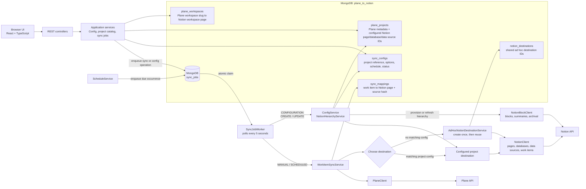

# Plane to Notion Connector Architecture

Current implementation: a React + TypeScript control UI and one Java 21 / Spring Boot service. The service exposes the local REST API and runs a single background worker that claims durable jobs from MongoDB.

## Job and destination behavior

- The `sync_jobs` collection is the durable queue for `MANUAL`, `SCHEDULED`, and `CONFIGURATION` jobs. Configuration jobs carry `CREATE` or `UPDATE`; only manual and scheduled sync jobs appear in run history.
- Config creation and updates return before Notion provisioning finishes. The UI shows `PROVISIONING` or `UPDATING` until the worker completes the operation and sets `READY` or `FAILED`.
- A sync uses the Notion destination IDs stored on its `plane_projects` record when a matching config exists. An unconfigured task URL uses the shared destination, whose IDs are stored in `notion_destinations` and provisioned lazily on first use.
- `NotionClient` handles page, database, data-source, and work-item operations. `NotionBlockClient` handles block reads/writes, hierarchy summaries, and page archival.
- `sync_configs` stores a reference to a Plane project record plus sync options, schedule, and lifecycle/operation status. It does not own the Notion destination IDs.
- Project sync uses checkpointed reads for active, non-draft Plane work items. Work-item mappings and source hashes make writes idempotent and skip unchanged Notion updates.
